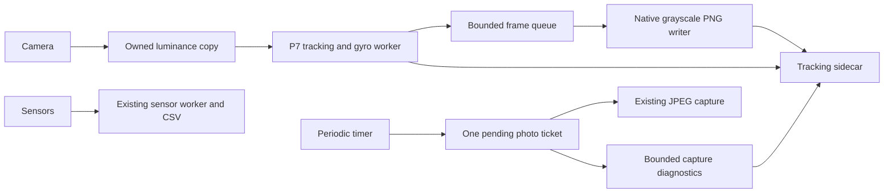

# P9 plan: continuous tracking with periodic high-quality stills

Decision, 2026-10-27: prioritize the intended continuous handheld capture over
relocalization between deliberately separated still viewpoints. Frequent
low-resolution frames should reduce inter-frame displacement and provide
temporal tracks between high-quality stills. This is a design expectation to
measure, not evidence that lighting changes or tracking loss are solved.

## Starting point and proposed capture

The existing [P7 implementation](preview_tracking.md) already binds CameraX
`Preview`, `ImageAnalysis` and `ImageCapture` when the device supports the
combination without reducing the baseline JPEG resolution. Analysis requests
640×480 YUV; `PreviewAnalyzer` owns cropped/sampled luminance copies and processes
at most 10 Hz. `LivePreviewProcessor` tracks points and integrates recorded gyro
samples. Pixels remain in the native unrotated frame. Preview data and diagnostic
logs were diagnostic-only in P7. **P9.2 now saves the selected tracking frames and
diagnostics, and adds optional periodic JPEG capture in app 0.5.0.**
[P9.3 hybrid replay](hybrid_replay.md) extends the same P8 command with
image-verified JPEG observations carried by continuous preview tracks.

P9.2 reuses that stream for continuous tracking, retains timestamped frames for
offline replay, and requests a high-quality JPEG approximately once per second.
The initial build uses the current analysis budget and a configurable 1 s still interval.
Measure frame interval distributions, longest gaps, capture latency, memory,
storage and track survival before increasing frame rate or image size. One
second is a starting cadence; it does not guarantee useful parallax, a sharp
image or timely completion. One still may be in flight; missed requests must
not build an unbounded queue or trigger a catch-up burst.

A low-resolution encoded video may become a useful storage option. The first
step needs replayable tracking frames with reliable camera timestamps; it does
not require another camera use case or audio. CameraX supports concurrent
analysis and still capture as an architectural pattern, but adding encoded video
can require a stream combination the camera does not support. Reusing the
existing analysis stream is the initial implementation choice, subject to
device measurements. See the official [CameraX architecture](https://developer.android.com/media/camera/camerax/architecture),
[analysis backpressure](https://developer.android.com/media/camera/camerax/analyze)
and [video stream-combination limits](https://developer.android.com/media/camera/camerax/video-capture#bind-videocapture).

## Recording and geometry requirements

P9.1 must define a versioned optional sidecar before implementing its writer.
The [P9.1 contract and Python ingestion](tracking_capture_format.md) implement
that first step; P9.2 now supplies the Android writer and scheduler below.
Preserve the current [still/sensor contract](capture_format.md) and old sessions.
Give tracking frames and stills separate stable identities. Persist actual
camera timestamps and declared clock domains, original and saved dimensions,
crop/sample/rotation transforms, camera/lens identity, intrinsic provenance and
diagnostic gaps/resets. Bounded asynchronous export must record storage losses;
keep-only-latest acquisition is intentionally allowed to drop frames and must
not be described as a constant-rate recording.

Retain request, exposure/frame and callback timing separately. A scheduled tick
does not identify when a JPEG was exposed. Unknown camera clocks cannot silently
be treated as the sensor clock. A future video container's presentation times
also need an explicit relationship to camera/sensor timestamps for gyro replay.
Correct the hardcoded app-version session label as part of provenance work.

Preview and JPEG streams can differ in crop, intrinsics, distortion and time.
Do not multiply low-resolution pixel coordinates by a width ratio or assign a
JPEG the nearest preview pose without verifying the geometry. P9.3 should reuse
the existing projection, guided correspondence, PnP and refinement gates to
connect high-quality stills to the tracked map. Timestamps constrain association;
image evidence validates it. Preserve explicit unsupported segments.

Timed stills are the first measurable baseline. The existing keyframe hint uses
consecutive processed preview frames; it does not accumulate parallax since the
last selected still. Adaptive still selection therefore needs its own keyframe
reference and evidence, reusing the existing policy where appropriate.

## P9.2 implementation and use

App **0.5.0 / version code 6** enables automatic photos by default during an
active foreground timeline. Before Start, choose an interval of 0.25–60 s
(default 1 s), or uncheck **Automatic photos** for manual stills with tracking
frame export. The manual photo button remains available when no photo is in
flight. These settings remain fixed until that session finishes.

`PreviewAnalyzer` timestamps reception, copies owned luminance, releases the
camera buffer, and calls the existing `LivePreviewProcessor`. The processor
retains its one-frame gyro delay and emits the exact model/diagnostics for the
frame being processed. End flushes the final delayed frame on that same worker.
`PreviewNativeRuntime` shares the existing OpenCV initialization between tracking
and the PNG encoder; no camera use case or dependency was added.

`TrackingFrameWriter` owns one I/O thread, at most four waiting pixel copies plus
one being encoded, at most 32 waiting capture decisions, and a bounded number of
drop ranges (one pending range plus ranges preceding queued frames). It never
submits a new executor task or writes a PNG on the sensor/analysis worker for
each frame. The existing OpenCV encoder writes `CV_8UC1` PNGs to temporary files,
then publishes them before appending frame records. Session and tracking
manifests share the original synced/atomic JSON publication helper.

Full pixel queues produce explicit `writer_queue_full` ID ranges. PNG failures
remove temporary output, record `frame_storage_error`, preserve later successes
and finalize as interrupted. A saturated diagnostic queue stops accepting new
export work with `diagnostic_queue_full`; it cannot grow indefinitely or claim a
complete export. A hard metadata/storage failure leaves an interrupted manifest
where storage permits; the raw session may remain incomplete. Photos/sensors do
not wait for PNG encoding. Queue wait/export time is recorded per saved frame.

`PeriodicStillSchedule` uses elapsed-realtime deadlines anchored to session start.
It records missed intervals as an aggregate skipped range, then considers only
one latest tick. Busy cameras produce `camera_busy`; delayed UI requests expire
as `request_delayed` before newer tick decisions. At most one automatic request
waits on the UI queue. `AutomaticStillGate` checks both path and tick so a late
callback cannot take a photo in the next session. Existing `RecordingSession`
enforces one pending photo across manual and automatic requests; failed/expired
tickets are invalidated before late camera buffers are considered for saving.
Actual JPEG exposure/request/callback metadata remains in the original events.

App **0.5.1 (code 7)** refines foreground End: the timer and new-photo gate stop
immediately, but analysis stays active while the existing JPEG settles. After
that, `PreviewEndPolicy` requires a queued preview with a comparable camera
timestamp strictly later than the last saved photo boundary. If exact exposure
time is unavailable, the later callback boundary is used explicitly; it does
not become an exposure timestamp. After JPEG completion, the preview wait is
bounded to 2 s. Unknown preview clocks, unavailable streams, background and
destruction stop promptly. The existing 30 s photo watchdog remains separate.

`RecordingState.acceptsPreview` keeps the Activity's gate aligned with that
worker decision while all capture/start/end controls remain disabled. Per-session
export bindings own their latest queued timestamp, preventing a previous
session's callbacks from satisfying the next one's End. `session.json` includes
optional `preview_end` diagnostics with the decision, photo boundary/source and
last queued comparable preview timestamp. Queued admission is distinguished
from successful storage; the existing writer still drains and reports failures.
Backgrounding during a user End escalates the final session to interrupted.

End/background stops the timer and clears pending automatic UI work. Foreground
End uses the bounded post-JPEG preview tail above; background closes the analyzer
gate immediately. The analyzer flushes its delayed frame, and accepted JPEGs
must settle before the sensor timeline closes while bounded tracking I/O
drains asynchronously. Start remains disabled during finalization, so a new
session cannot inherit old frames or native state. Activity destruction closes
the analysis/native processor after this barrier. End can remain in finishing
state while storage drains; no additional PNG work is put on the sensor worker.

The JPEG-resolution-preserving CameraX fallback is unchanged. Unsupported
analysis/native loading gets an explicit unavailable tracking sidecar; a stream
lost after frames were saved gets an interrupted sidecar. JPEG controls remain
usable. The existing consecutive-preview keyframe hint never triggers photos;
the first P9.2 capture baseline uses the timer independently of that hint.

Validation and install artifacts are published in
`data/processed/p9_capture/`. JVM writer tests use original known PNG/JPEG fixture
bytes and independently validate complete and loss-case exports through the
Python reader. Native OpenCV encoding has an additional compiled instrumentation
test, separate from JVM tests and real camera acceptance.

## Order and phone-test boundary

The actionable tasks and acceptance criteria are [P9.1–P9.4 in TODO.md](../../TODO.md#p9--continuous-tracking-frames-with-periodic-high-quality-stills):
define/load the format, implement bounded capture and scheduling, extend P8
replay, then validate the combined mode on a phone. Synthetic, Python, JVM,
build and native-compilation work can proceed now. P9.1 supplies the format and
offline ingestion; P9.2 supplies capture; P9.3 adds offline reconstruction.

No additional still-only physical test is needed before that development. The
earlier October 27 session supplies still/sensor evidence, but contains no saved
preview sequence, so it cannot establish video continuity, preview performance
or simultaneous-stream behavior. P7 physical acceptance remains pending.

The later `2026-10-27_153337_135_48fb0956` session now supplies real simultaneous
preview/JPEG/sensor evidence on app 0.5.0. Its
[capture assessment](../../data/processed/2026-10-27_153337_135_48fb0956/REPORT.md)
records 435 previews, 29 JPEGs, 7.498 Hz saved preview rate, no writer drops and
roughly 2 s actual still cadence despite the 1 s timer. The last JPEG lacks a
following preview at End; dual-preview replay labels it unsupported. UI/native
instrumentation and end/restart acceptance remain pending. Measure still
latency and preserve the final JPEG's preview bracket in subsequent tuning.

Once the hybrid build is ready, use one 20–30 s phone session with gentle
translation, rotation and a brief hold over textured content, plus an end/restart
check. Export frames, stills, sensors and diagnostics. Verify full JPEG dimensions,
actual tracking cadence and gaps during photos, clock/gyro coverage, drops and
session isolation, and replay the capture through P8. Record native device-test
results separately. That session can provide both P7 camera-behavior evidence
and P9 hybrid-capture evidence; neither is a prerequisite for starting offline
development. Device support and sustained performance cannot be certified from
this container.
